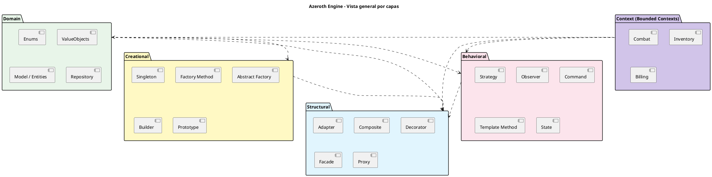
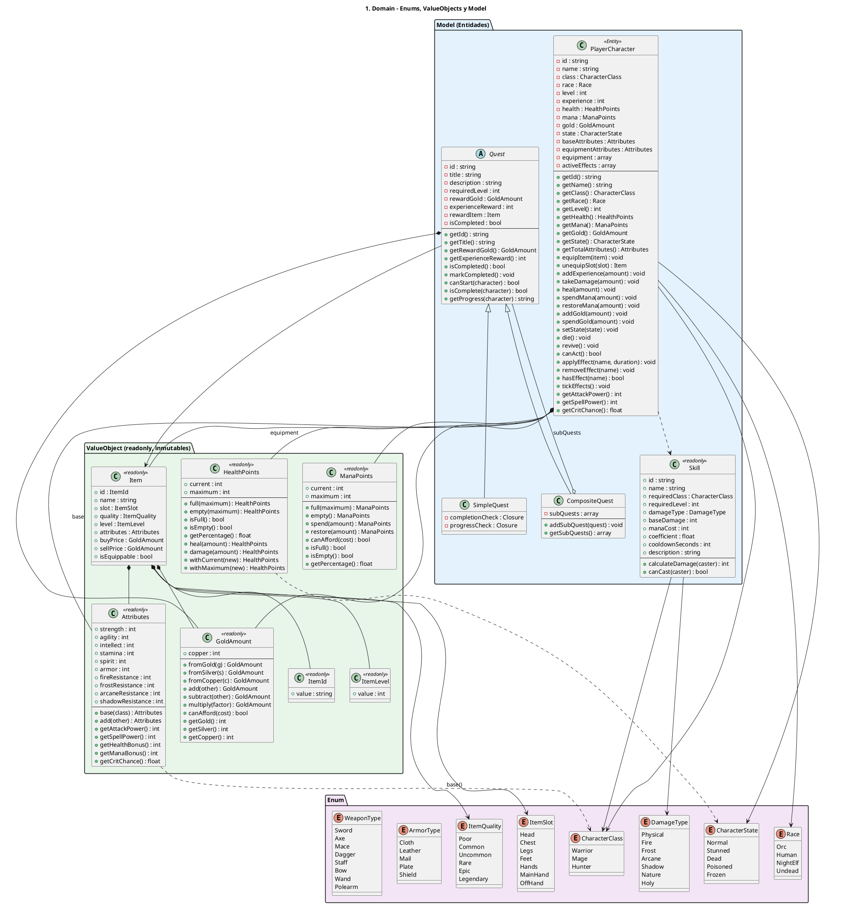
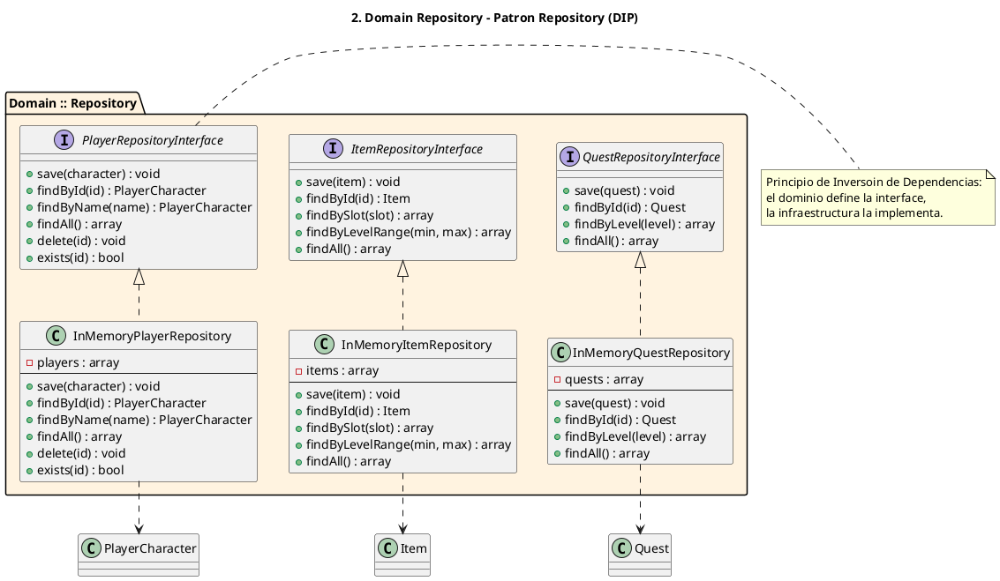
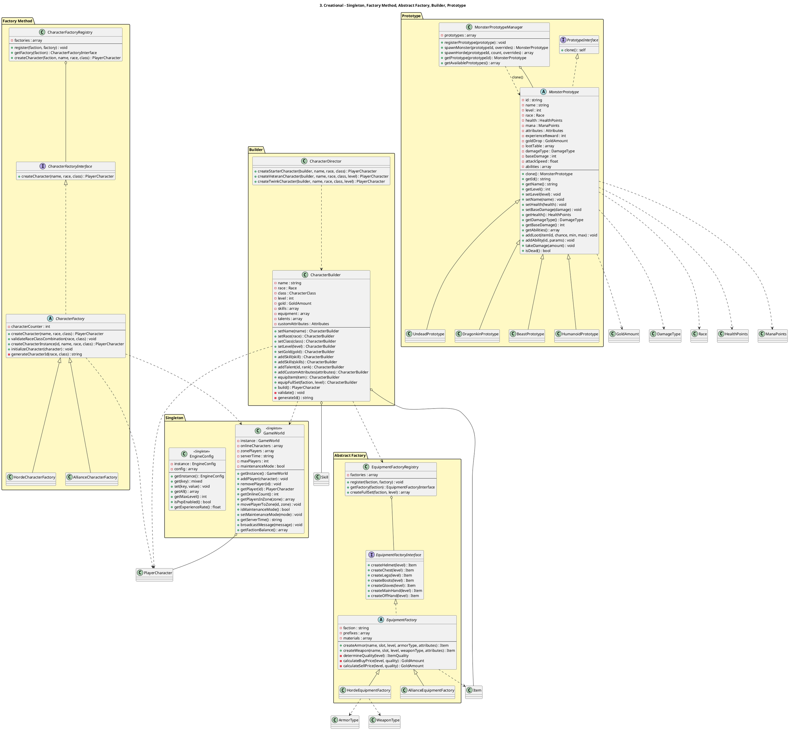
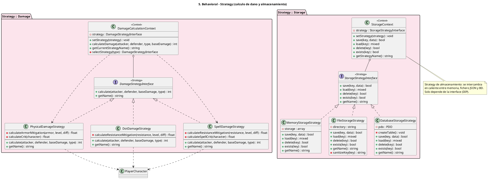

# 📐 Diagramas de Clases — Azeroth Engine

> **131 clases** modeladas en **7 diagramas** PlantUML, separados por capa arquitectónica.
>
> **Cómo verlo:** copia el bloque en <http://www.plantuml.com/plantuml> y pulsa *Submit Diagram*,
> o usa la extensión *PlantUML* de VS Code / IntelliJ / Eclipse.

### ⚠️ Nota de sintaxis (si tu PlantUML da error)

Este fichero usa **solo sintaxis básica y universal** de PlantUML. Evita a propósito:

| Construcción evitada | Motivo |
|---|---|
| `+{abstract} metodo()` / `-{static} $campo` | Las llaves `{ }` dentro del cuerpo de una clase **rompen el parser** de PlantUML |
| `+metodo() : ?Item` | El `?` de los tipos anulables produce errores en versiones antiguas |
| `+__construct(int ... )` | Los parámetros variádicos (`...`) no son portables |
| `o-- "*" Item` | Las multiplicidades entrecomilladas no están soportadas en todas las versiones |
| Emojis en `title` | Problemas de codificación en servidores con UTF-8 deshabilitado |

El `?` de nulabilidad y los `static` se documentan en las tablas al final de cada sección.

---

## 0. Resumen de la Arquitectura

---

## 1. Dominio — Enums, Value Objects y Entidades

> **Nulabilidad en el código real:** `PlayerCharacter.getEquippedItem(): ?Item`,
> `Quest.rewardItem: ?Item`, `Item` sin restricción, etc.
> Se omiten aquí para máxima compatibilidad.

---

## 2. Repositorios (DIP)

---

## 3. Patrones Creacionales

---

## 4. Patrones Estructurales

```plantuml
@startuml
title 4. Structural - Adapter, Composite, Decorator, Facade, Proxy

package "Adapter" #E1F5FE {

  interface DamageCalculatorInterface {
    +calculateDamage(attacker, defender, type) : int
    +calculateHealing(healer, target) : int
  }

  class LegacyDamageCalculator <<Legacy>> {
    +computePhysicalDamage(attackerStats, defenderStats) : int
    +computeSpellDamage(attackerStats, defenderStats, school) : int
    +computeHealing(healerStats) : int
  }

  class LegacyDamageCalculatorAdapter <<Adapter>> {
    -legacyCalculator : LegacyDamageCalculator
    --
    +calculateDamage(attacker, defender, type) : int
    +calculateHealing(healer, target) : int
    -extractStats(character) : array
  }

  class ModernDamageCalculator {
    -calculateMitigation(resistance, level, diff) : float
    -calculateCritMultiplier(character) : float
    --
    +calculateDamage(attacker, defender, type) : int
    +calculateHealing(healer, target) : int
  }
}

package "Composite" #E1F5FE {

  interface QuestComponentInterface {
    +getId() : string
    +getTitle() : string
    +getDescription() : string
    +canStart(character) : bool
    +isComplete(character) : bool
    +getProgress(character) : string
    +getRewardGold() : GoldAmount
    +getExperienceReward() : int
    +markCompleted() : void
    +isCompleted() : bool
  }

  abstract class QuestComponent {
    -id : string
    -title : string
    -description : string
    -rewardGold : GoldAmount
    -experienceReward : int
    -rewardItem : Item
    -isCompleted : bool
    --
    +getId() : string
    +getTitle() : string
    +getRewardGold() : GoldAmount
    +markCompleted() : void
    +isCompleted() : bool
  }

  class QuestObjective <<Leaf>> {
    -requiredLevel : int
    -completionCheck : Closure
    -progressCheck : Closure
    --
    +canStart(character) : bool
    +isComplete(character) : bool
    +getProgress(character) : string
  }

  class QuestComposite <<Composite>> {
    -children : array
    --
    +add(component) : void
    +remove(component) : void
    +getChildren() : array
    +canStart(character) : bool
    +isComplete(character) : bool
    +getProgress(character) : string
  }

  class QuestLog {
    -quests : array
    --
    +addQuest(quest) : void
    +removeQuest(id) : void
    +getQuest(id) : QuestComponentInterface
    +getActiveQuests() : array
    +getCompletedQuests() : array
    +getAvailableQuests(character) : array
    +getQuestProgress(character) : string
    +completeQuest(id, character) : bool
  }
}

package "Decorator" #E1F5FE {

  interface WeaponInterface {
    +getName() : string
    +getBaseDamage() : int
    +getDamageType() : DamageType
    +getAttributes() : Attributes
    +getAttackSpeed() : float
    +calculateDPS(character) : float
  }

  class BaseWeapon {
    -item : Item
    --
    +getName() : string
    +getBaseDamage() : int
    +getDamageType() : DamageType
    +getAttributes() : Attributes
    +getAttackSpeed() : float
    +calculateDPS(character) : float
  }

  abstract class WeaponDecorator {
    -weapon : WeaponInterface
    --
    +getName() : string
    +getBaseDamage() : int
    +getDamageType() : DamageType
    +getAttributes() : Attributes
    +getAttackSpeed() : float
    +calculateDPS(character) : float
  }

  class FireEnchantment {
    -fireDamage : int
    -procChance : float
    --
    +getFireDamage() : int
    +getProcChance() : float
  }

  class FrostEnchantment {
    -frostDamage : int
    -slowChance : float
    -slowPercent : float
  }

  class ArcaneEnchantment {
    -arcaneDamage : int
    -manaBurnChance : float
    -manaBurnAmount : int
  }

  class LifestealEnchantment {
    -lifestealPercent : float
    --
    +getHealAmount(damageDealt) : int
  }

  class CrusaderEnchantment {
    -strengthBonus : int
    -procChance : float
    -duration : int
  }

  class EnchantmentFactory {
    +applyEnchantment(weapon, type, params) : WeaponInterface
    +applyMultiple(weapon, enchantments) : WeaponInterface
  }
}

package "Facade" #E1F5FE {

  class GameCombatFacade <<Facade>> {
    -damageCalculator : DamageCalculatorInterface
    -notifier : CombatNotifier
    -damageContext : DamageCalculationContext
    -combatLog : array
    -round : int
    --
    +startCombat(attacker, defender) : CombatResult
    +executeSkill(caster, target, skill) : SkillResult
    +autoAttack(attacker, defender) : SkillResult
    +heal(healer, target, amount) : HealResult
    +getCombatLog() : array
    +addCombatObserver(observer) : void
    -validateCombatants(attacker, defender) : void
    -processRound(attacker, defender, stateA, stateB) : void
    -isCombatOver(attacker, defender) : bool
    -determineResult(attacker, defender) : CombatResult
  }

  class CombatResult {
    +ATTACKER_WINS : string
    +DEFENDER_WINS : string
    +DRAW : string
    +outcome : string
    +attacker : PlayerCharacter
    +defender : PlayerCharacter
    +rounds : int
    +log : array
    --
    +getWinner() : PlayerCharacter
  }

  class SkillResult {
    +success : bool
    +damage : int
    +message : string
  }

  class HealResult {
    +amount : int
    +message : string
  }
}

package "Proxy" #E1F5FE {

  interface GameServiceInterface {
    +enterZone(character, zoneId) : bool
    +purchaseItem(character, item) : bool
    +accessBank(character) : array
    +joinBattleground(character) : bool
    +useAuctionHouse(character) : bool
    +sendMail(from, to, subject, body, item, cod) : bool
  }

  class GameService <<RealSubject>> {
    +enterZone(character, zoneId) : bool
    +purchaseItem(character, item) : bool
    +accessBank(character) : array
    +joinBattleground(character) : bool
    +useAuctionHouse(character) : bool
    +sendMail(from, to, subject, body, item, cod) : bool
  }

  enum AccountTier {
    Free
    Premium
    Veteran
    GM
  }

  class AccountSecurityProxy <<Proxy>> {
    -realService : GameServiceInterface
    -premiumZones : array
    -veteranZones : array
    --
    +enterZone(character, zoneId) : bool
    +purchaseItem(character, item) : bool
    +accessBank(character) : array
    +joinBattleground(character) : bool
    +useAuctionHouse(character) : bool
    +sendMail(from, to, subject, body, item, cod) : bool
    -getAccountTier(character) : AccountTier
    -hasAccess(current, required) : bool
  }

  class LoggingProxy <<Proxy>> {
    -realService : GameServiceInterface
    --
    -log(method, params) : void
  }
}

DamageCalculatorInterface <|.. LegacyDamageCalculatorAdapter
DamageCalculatorInterface <|.. ModernDamageCalculator
LegacyDamageCalculatorAdapter o-- LegacyDamageCalculator

QuestComponentInterface <|.. QuestComponent
QuestComponent <|-- QuestObjective
QuestComponent <|-- QuestComposite
QuestComposite o-- QuestComponentInterface
QuestLog o-- QuestComponentInterface

WeaponInterface <|.. BaseWeapon
WeaponInterface <|.. WeaponDecorator
BaseWeapon o-- Item
WeaponDecorator o-- WeaponInterface
WeaponDecorator <|-- FireEnchantment
WeaponDecorator <|-- FrostEnchantment
WeaponDecorator <|-- ArcaneEnchantment
WeaponDecorator <|-- LifestealEnchantment
WeaponDecorator <|-- CrusaderEnchantment
EnchantmentFactory ..> WeaponInterface

GameCombatFacade *-- DamageCalculatorInterface
GameCombatFacade *-- CombatNotifier
GameCombatFacade *-- DamageCalculationContext
GameCombatFacade ..> CombatResult
GameCombatFacade ..> SkillResult
GameCombatFacade ..> HealResult
GameCombatFacade ..> CharacterStateContext
GameCombatFacade ..> Skill

GameServiceInterface <|.. GameService
GameServiceInterface <|.. AccountSecurityProxy
GameServiceInterface <|.. LoggingProxy
AccountSecurityProxy o-- GameServiceInterface
AccountSecurityProxy --> AccountTier
LoggingProxy o-- GameServiceInterface

@enduml
```

---

## 5. Strategy — Daño y Almacenamiento

---

## 6. Observer, Command, Template Method y State

```plantuml
@startuml
title 6. Behavioral - Observer, Command, Template Method, State

package "Observer" #FCE4EC {

  interface ObserverInterface {
    +update(event, data) : void
  }

  interface ObservableInterface {
    +addObserver(observer) : void
    +removeObserver(observer) : void
    +notify(event, data) : void
  }

  class CombatNotifier <<Subject>> {
    -observers : array
    --
    +addObserver(observer) : void
    +removeObserver(observer) : void
    +notify(event, data) : void
    +notifyCombatStart(attacker, defender) : void
    +notifyCombatEnd(attacker, defender, result) : void
    +notifyDamageDealt(attacker, defender, damage, type, source) : void
    +notifyHealing(healer, target, amount) : void
    +notifyLevelUp(character, newLevel) : void
    +notifySkillCast(caster, skill, target) : void
    +notifyItemLooted(character, item, quantity) : void
    +notifyQuestCompleted(character, quest) : void
  }

  class ConsoleLogger {
    +update(event, data) : void
  }

  class FileLogger {
    -logFile : string
    --
    +update(event, data) : void
  }

  class UIUpdater {
    -uiState : array
    --
    +update(event, data) : void
    +getUIState(event) : array
    +getAllUIState() : array
  }

  class CharacterObserver {
    -character : PlayerCharacter
    --
    +update(event, data) : void
  }
}

package "Command" #FCE4EC {

  interface CommandInterface <<Command>> {
    +execute() : CommandResult
    +undo() : CommandResult
    +getName() : string
    +canExecute() : bool
  }

  class CommandResult {
    +success : bool
    +message : string
    +data : mixed
  }

  abstract class BaseCommand {
    -caster : PlayerCharacter
    -target : PlayerCharacter
    -skill : Skill
    -damageContext : DamageCalculationContext
    -lastResult : CommandResult
    --
    +getName() : string
    +canExecute() : bool
    +execute() : CommandResult
    +undo() : CommandResult
  }

  class CastSpellCommand {
    -damageDealt : int
    -manaSpent : int
    -targetPreviousHealth : int
    -casterPreviousMana : int
  }

  class HealCommand {
    -healAmount : int
    -targetPreviousHealth : int
    -casterPreviousMana : int
  }

  class BuffCommand {
    -buffName : string
    -duration : int
    -statModifiers : array
  }

  class CommandQueue <<Invoker>> {
    -queue : array
    -history : array
    -maxHistorySize : int
    --
    +enqueue(command) : void
    +executeNext() : CommandResult
    +executeAll() : array
    +undoLast() : CommandResult
    +getQueueSize() : int
    +getHistorySize() : int
    +clear() : void
  }

  class MacroCommand {
    -commands : array
    -name : string
    --
    +addCommand(command) : void
    +execute() : CommandResult
    +undo() : CommandResult
    +getName() : string
    +canExecute() : bool
  }
}

package "Template Method" #FCE4EC {

  abstract class QuestCompletionTemplate <<TemplateMethod>> {
    +completeQuest(character) : QuestCompletionResult
    -onPreCompletion(character) : void
    -validateCompletion(character) : bool
    -calculateRewards(character) : QuestRewards
    -grantRewards(character, rewards) : void
    -onPostCompletion(character, rewards) : void
    -canStart(character) : bool
  }

  class QuestRewards {
    +experience : int
    +gold : GoldAmount
    +items : array
    +reputation : array
    --
    +add(other) : QuestRewards
  }

  class QuestCompletionResult {
    +success : bool
    +message : string
    +rewards : QuestRewards
  }

  class SimpleQuestCompletion {
    -questId : string
    -questTitle : string
    -requiredLevel : int
    -experienceReward : int
    -goldReward : GoldAmount
    -itemReward : Item
    -objectiveCheck : Closure
  }

  class ChainQuestCompletion {
    -chain : array
    -currentStep : int
    --
    +addStep(step) : void
  }

  class DailyQuestCompletion {
    -questId : string
    -title : string
    -requiredLevel : int
    -baseExperience : int
    -baseGold : GoldAmount
    -objectiveCheck : Closure
    -completedToday : array
  }
}

package "State" #FCE4EC {

  interface StateInterface <<State>> {
    +enter(character) : void
    +exit(character) : void
    +update(character) : void
    +onDamageTaken(character, amount) : void
    +onHeal(character, amount) : void
    +canAttack() : bool
    +canMove() : bool
    +canCast() : bool
    +getState() : CharacterState
  }

  abstract class BaseState {
    -state : CharacterState
    --
    +enter(character) : void
    +exit(character) : void
    +update(character) : void
    +onDamageTaken(character, amount) : void
    +onHeal(character, amount) : void
    +canAttack() : bool
    +canMove() : bool
    +canCast() : bool
    +getState() : CharacterState
  }

  class NormalState
  class StunnedState {
    -remainingDuration : int
  }
  class DeadState {
    -releaseTimer : int
  }
  class PoisonedState {
    -tickDamage : int
    -remainingDuration : int
    -tickInterval : int
  }
  class FrozenState {
    -remainingDuration : int
  }

  class CharacterStateContext <<Context>> {
    -character : PlayerCharacter
    -currentState : StateInterface
    --
    +transitionTo(newState, params) : void
    +tick() : void
    +onDamageTaken(amount) : void
    +onHeal(amount) : void
    +canAttack() : bool
    +canMove() : bool
    +canCast() : bool
    +getCurrentState() : CharacterState
    -createState(state, params) : StateInterface
  }
}

ObserverInterface <|.. ConsoleLogger
ObserverInterface <|.. FileLogger
ObserverInterface <|.. UIUpdater
ObserverInterface <|.. CharacterObserver
ObservableInterface <|.. CombatNotifier
CombatNotifier o-- ObserverInterface
CharacterObserver o-- PlayerCharacter

CommandInterface <|.. BaseCommand
CommandInterface <|.. MacroCommand
BaseCommand <|-- CastSpellCommand
BaseCommand <|-- HealCommand
BaseCommand <|-- BuffCommand
BaseCommand o-- PlayerCharacter
BaseCommand o-- Skill
BaseCommand *-- DamageCalculationContext
BaseCommand ..> CommandResult
CommandQueue o-- CommandInterface
MacroCommand o-- CommandInterface

QuestCompletionTemplate <|-- SimpleQuestCompletion
QuestCompletionTemplate <|-- ChainQuestCompletion
QuestCompletionTemplate <|-- DailyQuestCompletion
QuestCompletionTemplate ..> QuestCompletionResult
QuestCompletionTemplate ..> QuestRewards
QuestCompletionTemplate ..> PlayerCharacter
QuestRewards *-- GoldAmount
ChainQuestCompletion o-- QuestCompletionTemplate

StateInterface <|.. BaseState
BaseState <|-- NormalState
BaseState <|-- StunnedState
BaseState <|-- DeadState
BaseState <|-- PoisonedState
BaseState <|-- FrozenState
CharacterStateContext o-- StateInterface
CharacterStateContext o-- PlayerCharacter
BaseState --> CharacterState
NormalState ..> PlayerCharacter
PoisonedState ..> PlayerCharacter
FrozenState ..> PlayerCharacter

note bottom of QuestCompletionTemplate
  completeQuest() es final: define el esqueleto
  y delega los pasos en los metodos sobrescritos.
end note

@enduml
```

---

## 7. Bounded Contexts (DDD)

```plantuml
@startuml
title 7. Contexto Delimitado - Combat, Inventory, Billing

package "Combat" #D1C4E9 {

  class CombatService {
    -combatFacade : GameCombatFacade
    -damageContext : DamageCalculationContext
    --
    +initiateCombat(attacker, defender) : CombatResult
    +castSpell(caster, target, skill) : SkillResult
    +autoAttack(attacker, defender) : SkillResult
    +heal(healer, target, amount) : HealResult
    +calculateDamage(attacker, defender, type, baseDamage) : int
    +setDamageStrategy(strategy) : void
  }

  interface CombatRepositoryInterface {
    +saveCombatLog(id, log) : void
    +getCombatLog(id) : array
  }

  class InMemoryCombatRepository {
    -logs : array
    --
    +saveCombatLog(id, log) : void
    +getCombatLog(id) : array
  }
}

package "Inventory" #D1C4E9 {

  class InventoryAggregate <<Aggregate Root>> {
    -characterId : string
    -equippedItems : array
    -bagItems : array
    -bagCapacity : int
    -version : int
    --
    +getCharacterId() : string
    +getEquippedItems() : array
    +getBagItems() : array
    +getBagCapacity() : int
    +getBagUsedSlots() : int
    +getBagFreeSlots() : int
    +getVersion() : int
    +equipItem(item) : bool
    +unequipItem(slot) : Item
    +addToBag(item) : bool
    +removeFromBag(itemId) : Item
    +moveToBag(slot) : bool
    +expandBag(slots) : void
    +getTotalWeight() : int
  }

  interface InventoryRepositoryInterface {
    +save(inventory) : void
    +findByCharacterId(characterId) : InventoryAggregate
    +delete(characterId) : void
  }

  class InMemoryInventoryRepository {
    -inventories : array
    --
    +save(inventory) : void
    +findByCharacterId(characterId) : InventoryAggregate
    +delete(characterId) : void
  }

  class InventoryService {
    -repository : InventoryRepositoryInterface
    --
    +getInventory(characterId) : InventoryAggregate
    +equipItem(characterId, item) : bool
    +unequipItem(characterId, slot) : Item
    +addItemToBag(characterId, item) : bool
    +removeItemFromBag(characterId, itemId) : Item
    +expandBag(characterId, slots) : void
  }
}

package "Billing" #D1C4E9 {

  interface PaymentMethodInterface {
    +charge(amount) : PaymentResult
    +refund(amount) : PaymentResult
    +getName() : string
  }

  class PaymentResult {
    +success : bool
    +transactionId : string
    +message : string
  }

  class InGameGoldPayment {
    -character : PlayerCharacter
    --
    +charge(amount) : PaymentResult
    +refund(amount) : PaymentResult
    +getName() : string
  }

  class RealMoneyPayment {
    -accountId : string
    -balance : float
    --
    +charge(amount) : PaymentResult
    +refund(amount) : PaymentResult
    +getName() : string
    +getBalance() : float
    +addFunds(amount) : void
  }

  class Subscription <<Entity>> {
    -accountId : string
    -tier : string
    -startDate : DateTimeImmutable
    -endDate : DateTimeImmutable
    -autoRenew : bool
    -paymentMethodId : string
    --
    +getAccountId() : string
    +getTier() : string
    +isActive() : bool
    +isAutoRenew() : bool
    +getDaysRemaining() : int
    +renew(months) : void
    +cancel() : void
  }

  interface SubscriptionRepositoryInterface {
    +findByAccountId(accountId) : Subscription
    +save(subscription) : void
  }

  class InMemorySubscriptionRepository {
    -subscriptions : array
    --
    +findByAccountId(accountId) : Subscription
    +save(subscription) : void
  }

  class BillingService {
    -subscriptionRepository : SubscriptionRepositoryInterface
    --
    +purchaseSubscription(accountId, tier, months, paymentMethod) : PaymentResult
    +cancelSubscription(accountId) : bool
    +getSubscriptionStatus(accountId) : array
    +processRenewals(paymentMethod) : array
  }

  class AuctionListing <<Entity>> {
    +id : string
    +sellerId : string
    +sellerName : string
    +item : Item
    +startingBid : GoldAmount
    +currentBid : GoldAmount
    +buyoutPrice : GoldAmount
    +startTime : DateTimeImmutable
    +endTime : DateTimeImmutable
    +deposit : GoldAmount
    +currentBidderId : string
  }

  class BidResult {
    +success : bool
    +transactionId : string
    +message : string
  }

  class AuctionHouseService {
    -listings : array
    -commissionRate : float
    --
    +createListing(seller, item, startingBid, buyoutPrice, hours) : AuctionListing
    +placeBid(listingId, bidder, bidAmount) : BidResult
    +buyout(listingId, buyer) : BidResult
    +getActiveListings() : array
    +getListing(listingId) : AuctionListing
    -finalizeSale(listing, buyer, finalPrice) : void
  }
}

CombatService *-- GameCombatFacade
CombatService *-- DamageCalculationContext
CombatService ..> PlayerCharacter
CombatService ..> Skill
CombatService ..> DamageType
CombatService ..> CombatResult
CombatRepositoryInterface <|.. InMemoryCombatRepository

InventoryRepositoryInterface <|.. InMemoryInventoryRepository
InMemoryInventoryRepository o-- InventoryAggregate
InventoryService *-- InventoryRepositoryInterface
InventoryService ..> InventoryAggregate
InventoryAggregate o-- Item
InventoryAggregate ..> ItemSlot
InventoryAggregate ..> ItemId

PaymentMethodInterface <|.. InGameGoldPayment
PaymentMethodInterface <|.. RealMoneyPayment
SubscriptionRepositoryInterface <|.. InMemorySubscriptionRepository
InMemorySubscriptionRepository o-- Subscription
BillingService *-- SubscriptionRepositoryInterface
BillingService ..> PaymentMethodInterface
BillingService ..> Subscription
BillingService ..> PaymentResult
InGameGoldPayment o-- PlayerCharacter
RealMoneyPayment ..> GoldAmount
AuctionHouseService o-- AuctionListing
AuctionHouseService ..> AuctionListing
AuctionHouseService ..> BidResult
AuctionHouseService ..> PlayerCharacter
AuctionListing o-- Item
AuctionListing o-- GoldAmount

note bottom of CombatService
  Cada Bounded Context expone
  un servicio de aplicacion propio
  y no comparte modelo con los demas.
end note

@enduml
```

---

## 📖 Convenciones del Diagrama

### Stereotipos

| Stereotipo | Significado |
|---|---|
| `<<Entity>>` | Entidad DDD con identidad persistente (ID único) |
| `<<Aggregate Root>>` | Raíz de agregado: único punto de entrada transaccional |
| `<<readonly>>` | Value Object inmutable (`readonly class` de PHP 8.2) |
| `<<Singleton>>` | Instancia única global |
| `<<Adapter>>` | Adapta una API legacy a la interfaz moderna |
| `<<Facade>>` | Punto de entrada simplificado a varios subsistemas |
| `<<Proxy>>` | Controla el acceso al objeto real |
| `<<RealSubject>>` | Objeto real envuelto por el Proxy |
| `<<Strategy>>` / `<<Context>>` | Algoritmo intercambiable / su selector en tiempo de ejecución |
| `<<Subject>>` | Observable del patrón Observer |
| `<<Command>>` / `<<Invoker>>` | Comando encapsulado / cola que lo ejecuta y deshace |
| `<<TemplateMethod>>` | Esqueleto de algoritmo con pasos sobrescritos |
| `<<State>>` | Estado del personaje |
| `<<Leaf>>` / `<<Composite>>` | Nodo hoja / nodo compuesto |

### Tipos de Relación

| Flecha | Relación | Ejemplo |
|---|---|---|
| `A <|-- B` | Herencia | `BaseState <|-- PoisonedState` |
| `A *-- B` | Composición (ciclo de vida atómico) | `Item *-- ItemId` |
| `A o-- B` | Agregación | `CombatNotifier o-- ObserverInterface` |
| `A ..> B` | Dependencia (uso, sin composición) | `GameWorld ..> PlayerCharacter` |
| `A <|.. B` | Realización (implementa interfaz) | `StorageContext <|.. StorageStrategyInterface` |

### Elementos omitidos por legibilidad

- **Constructores**: se omiten salvo que formen parte de la API pública relevante.
- **Tipos anulables** (`?Item`, `?GoldAmount`): se muestran sin el `?`; el detalle está en el código.
- **Modificadores `static`**: en el diagrama aparecen como atributos o métodos simples; en el código son `public static`.
- **Cuerpos de método**: solo las firmas.
- **Miembros privados de las implementaciones**: solo en las clases donde son relevantes para el patrón.

### Relaciones Clave del Diseño

1. **DIP** — `GameCombatFacade`, `CombatService`, `InventoryService` y `BillingService` dependen de **interfaces**, nunca de implementaciones concretas.
2. **LSP** — `LegacyDamageCalculatorAdapter` y `ModernDamageCalculator` son intercambiables donde se espera `DamageCalculatorInterface`.
3. **Alta cohesión** — cada Bounded Context (`Combat`, `Inventory`, `Billing`) tiene modelo, repositorios y servicios propios, sin dependencias cruzadas.
4. **Invariantes** — `InventoryAggregate` mantiene la consistencia entre equipamiento y bolsa; los Value Objects validan en su constructor y son inmutables.
